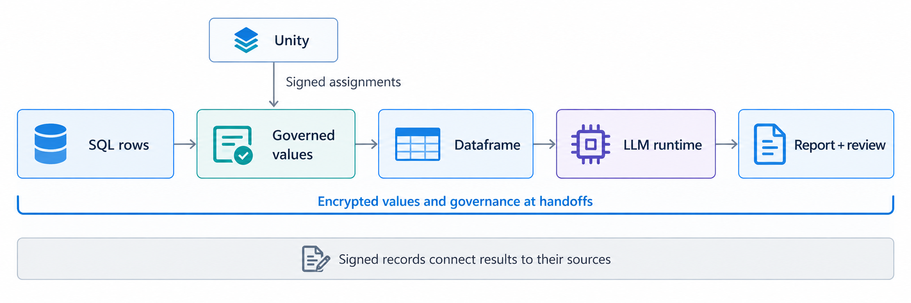
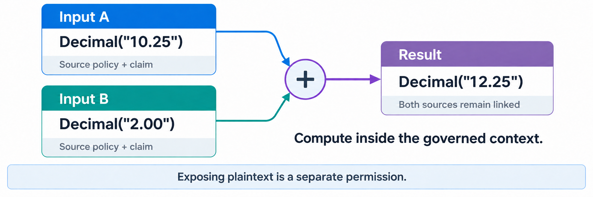
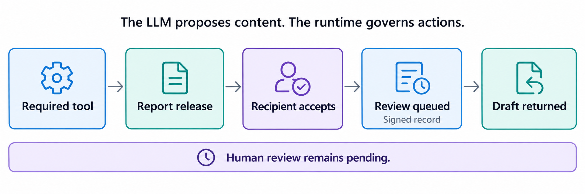

# Governance That Travels

Source companion to **Governance That Travels: Governed Values Across SQL, Dataframes, and Language Models**.

Applications can enforce access controls when reading a database and still lose the conditions attached to that data when they calculate a result or generate a report. A later recipient needs to know where the result came from, what the sources said about its use, and which required actions remain.

TN keeps that information connected to individual string and numeric values. A governed value carries the basis for accountable decisions about its use. Preserving a claim does not require every recipient to accept or obey it: the recipient evaluates the claimant and the claim under the authorities it recognizes and the requested use.

## Quick Start

The application queries governed values, calculates with them, and requests a report:

```python
rows = db.execute(
    "SELECT name, value FROM market_data LIMIT 3"
).fetchall()
with context:
    amount = dataframe_calculate(context, rows)
    brief = rows[0][0] + ": " + amount.as_string()
# Configure the model endpoint for this completed brief.
with context:
    report = endpoint.generate(brief, prompt=PROMPT)
```

Setup supplies `db` and `context`, then configures `endpoint` for the completed `brief`. The context checks operations against the applicable rules and records their outcomes. [The commented example below](#commented-walkthrough-of-the-papers-example) explains each call; [run.py](experiments/pvldb_evaluation/run.py) contains the full setup. In this example, `report.report_html` is the accepted draft and `report.review` identifies the queued review request.

## SQL-to-report example

Consider an analyst allowed to use market data internally. The data also carries a condition: a report generated by an LLM must display a review notice and be queued for human review. The application should return a useful draft with review pending.

This repository implements that path with synthetic data:



```text
SQLite name/value rows
  -> signed source assignments resolved through Unity
  -> governed strings and numbers
  -> governed Polars filtering, sorting, arithmetic and aggregation
  -> governed report input
  -> native LLM service and required logging tool
  -> encrypted report release and recipient acceptance
  -> signed registration of pending human review
  -> returned draft
```

The model generates report content. The runtime retains source policies, claims, and references to inputs. It checks tool calls and report transfers against the configured rules. Values and governance are encrypted in TN publications. Signed records identify the endpoint responsible for each statement and action.

A source statement remains attached to the data it describes. A recipient can retrieve that statement and verify its author. The receiving application separately checks whether its configured rules recognize that author for the requested use. For example, a statement that a company name is suitable for internal identification does not establish that a generated report is suitable for investment advice.

The review requirement has a different effect in this example: the receiving service is configured to apply it, so the application must queue review before returning the draft. Retaining a statement makes it available for evaluation; the configured rules determine the action. Combining values also records links to each input, so a recipient can trace the result back to its sources.

## Source Guide

The installed `deepvest_tn.governed` package provides `TNString`, `TNNumeric`, `Context`, and `GovernedSQL`. Application adapters are in `deepvest_tn`; the paper's workload drivers are in `experiments/pvldb_evaluation`.

| Source | What to read |
| --- | --- |
| [numeric.py](src/deepvest_tn/governed/numeric.py) | Numeric operators and preservation of the underlying Python numeric type |
| [string.py](src/deepvest_tn/governed/string.py) | Governed string methods, slicing, concatenation and exposure |
| [primitives.py](src/deepvest_tn/governed/primitives.py) | Authorization, opening values and publishing derived values |
| [sql.py](src/deepvest_tn/governed/sql.py) | Resolving source governance and returning governed SQL cells |
| [frames.py](experiments/pvldb_evaluation/frames.py) | SQL cells through governed Polars and back to a governed number |
| [numeric_profile.py](experiments/pvldb_evaluation/numeric_profile.py) | Exact dataframe types and range checks |
| [Native server](native/tn-llama) | Rust governance runtime, TN cryptography, C++ integration and pinned llama.cpp patch |
| [model.py](src/deepvest_tn/governed/model.py) | Native transfer to the model service and registration of pending review |
| [run.py](experiments/pvldb_evaluation/run.py) | Complete setup, execution and verification of the submission example |
| [evidence.py](src/deepvest_tn/governed/evidence.py) | Signed records of each context's operations |

`TNString` subclasses `str`, with a locator in the inherited string buffer. Its protected content is in the TN publication. `TNNumeric` refers to an encrypted number. It preserves `int`, `float`, and `Decimal` behavior by applying operations to the underlying values inside the authorized runtime. Scalar complex results are also supported. The SQL/dataframe example supports integers, floats and decimals.

Compute and expose are separate operations. For example, an authorized `upper()` returns a governed string. `reveal(context, destination=...)` returns an ordinary value only after the context permits that exposure and the endpoint can decrypt the content. Metadata operations use declared facts where available.

## Setup

Use Windows and Python 3.12 for the pinned native runtime. Run commands from the repository root in PowerShell.

```powershell
py -3.12 -m venv .venv
.\.venv\Scripts\Activate.ps1
python scripts/install.py
```

Place the supplied native TN wheel in `.runtime/dependencies/`, or set `TN_WHEEL` to its actual location. The installer checks its SHA-256 against [config/sdk-build.json](config/sdk-build.json), installs the bundled Polars adapter and model-client source, and installs this application. The wheel is an external binary dependency; it is not stored in this source repository.

The SQL/dataframe runs also require:

- A local Java Unity Catalog service, reachable at `http://127.0.0.1:8080` or the address passed with `--unity-url`. The runner creates a uniquely named catalog and registers its signed source assignments and editions. Use a local development instance that permits these requests. The application checks the signed assignments under its configured authority.
- An OPA executable, on `PATH` or selected through `TN_POLARS_OPA`. The adapter compiles the evaluator to Wasm and executes it with Wasmtime.

```powershell
$env:TN_POLARS_OPA = (Resolve-Path .runtime/dependencies/opa.exe).Path
```

The TN-enabled server source is included under `native/tn-llama`: the Rust governance runtime, TN cryptography, C++ integration, and the llama.cpp patch. The build script fetches llama.cpp at the pinned commit and links these components into `llama-server`. The Python transport client is under `dependencies/tn-llama-client`. Supply your own compatible GGUF model weights.

The runner launches the Linux server through WSL using drive-backed Windows paths. Build and run use your default WSL distribution. Set `TN_WSL_DISTRO` if you want a different installed distribution.

Rust verifies incoming TN publications, controls when the model can read their contents, runs required tools, and releases encrypted reports with their source governance. The C++ integration connects those checks to llama.cpp's inference loop.

- [Native inference integration](native/tn-llama/src/llama/server-tn.cpp)
- [Session and model transitions](native/tn-llama/crates/tn-runtime/src/session.rs)
- [Governed input verification](native/tn-llama/crates/tn-runtime/src/governed_input.rs)
- [Signed report publication](native/tn-llama/crates/tn-runtime/src/output_tn.rs)

### Build the included model server

In your chosen WSL distribution, install Git, CMake 3.24 or newer, Ninja, a C++ compiler, Python 3, and Rust 1.95 or newer. A CUDA build also requires the NVIDIA CUDA Toolkit with `nvcc` on PATH. CPU builds do not require CUDA.

From the repository root in PowerShell, build and run the complete example:

```powershell
py -3.12 scripts/run_submission.py --build-server cpu --run-directory experiments/results/full-report
```

Use `--build-server cuda` for GPU inference. CUDA builds target the installed GPU; set `TN_CUDA_ARCHITECTURES` to a CMake architecture list when building for another machine. `TN_BUILD_JOBS` controls compiler parallelism (default: 4). The same script can build the server directly from a Linux shell:

```bash
bash scripts/build_llama.sh cpu
```

The build installs `llama-server` **and its shared libraries** together in `.runtime/dependencies/tn-llama/`. The launcher discovers that server automatically. Keep the directory together when moving it. `build.json` records the backend and SHA-256 of every installed binary and library. `native/tn-llama/source-manifest.json` identifies the included source files and upstream revisions. Model weights are not downloaded by the build.

## Install Unity and run the complete example

The single-command launcher creates a Python environment, installs the application,
starts the Java Unity Catalog service in Docker, and requests a report from the LLM.
It checks the returned report and pending-review registration.
Docker Desktop must be running with Linux containers, and WSL must be available
for the TN-enabled model server. The Unity image is pinned by digest.

Place these external dependencies in `.runtime/dependencies/` under this checkout:

- `tn_proto-2026.9.10b2.dev2-cp39-abi3-win_amd64.whl`
- `opa.exe`
- One compatible `.gguf` model file

The directory is excluded from Git. After building the included server, run:

```powershell
py -3.12 scripts/run_submission.py --run-directory experiments/results/full-report
```

You can keep the files together elsewhere and pass `--dependency-dir` with that
directory. Individual command-line options override environment variables, which
override discovery in the dependency directory:

| File | Environment variable | Command-line override |
| --- | --- | --- |
| Native TN wheel | `TN_WHEEL` | `--tn-wheel` |
| OPA | `TN_POLARS_OPA` | `--opa` |
| TN-enabled model server | `TN_LLAMA_BINARY` | `--binary` |
| GGUF model | `TN_LLAMA_MODEL` | `--model-path` |

OPA can also be found on `PATH`. The launcher does not select an arbitrary
`llama-server` from `PATH`: it must be the TN-enabled server. If the dependency
directory contains multiple GGUF models, select one explicitly. Relative paths
supplied on the command line or through environment variables are resolved from
your current directory; the default dependency directory is relative to the checkout.
Invalid explicit paths produce an error rather than falling back to another file.

The launcher installs Unity automatically; model and native runtime files are
supplied separately. The default example uses one Decimal row.
Use `--numeric-type int` or `--numeric-type float` to select another numeric type.

To use your running Java Unity service, add `--unity-url http://127.0.0.1:8080`.
The launcher leaves that service running. A Unity container created by the launcher
is stopped when the run finishes; its container and data volume are retained.
The generated report is `report.html` and its review registration is `review.json`
in the selected run directory. Any failed generation or verification returns an error.

To install and start Unity separately:

```powershell
py -3.12 scripts/install_unity.py --port 18080
```

The installer pulls the official `unitycatalog/unitycatalog` image, which includes
Java, and publishes its API only on `127.0.0.1`. It creates a local demonstration
catalog with catalog-service authorization disabled; TN still verifies
signed source assignments. It does not modify an existing Unity installation.
The installer prints the container name and URL. Stop it with
`docker stop tn-submission-unity`; restart it with `docker start tn-submission-unity`.

## Run the numeric verification first



This command uses native encryption and signatures without a Unity or model connection:

```powershell
python -m deepvest_tn.governed.verify_numeric --run-directory experiments/results/numeric-check
```

It checks numeric round trips, arithmetic, type promotion, Decimal precision, equality and hashing, multiple-result operations, references to contributing inputs, claim attribution, authorization, decryption capability and signed records. It writes `numeric-verification.json` and the publications used for verification.

Every run directory must be new. Choose a different directory name for a second run.

## Run SQL through a dataframe

With Unity and OPA available:

```powershell
python -m experiments.pvldb_evaluation.run --mode primitive --rows 3 --numeric-type int --run-directory experiments/results/sql-int
python -m experiments.pvldb_evaluation.run --mode primitive --rows 3 --numeric-type float --run-directory experiments/results/sql-float
python -m experiments.pvldb_evaluation.run --mode primitive --rows 3 --numeric-type Decimal --decimal-precision 38 --decimal-scale 4 --run-directory experiments/results/sql-decimal
```

The runner creates a synthetic SQLite table, publishes signed column assignments, queries governed cells and performs the dataframe calculation. The default scalar step adds one to the aggregate.

| Selected type | Dataframe result for three rows | After the scalar increment |
| --- | --- | --- |
| `int` | `4503` | `4504` |
| `float` | `4503.375` | `4504.375` |
| `Decimal`, precision 38, scale 4 | `4503.3750` | `4504.3750` |

These are expected values for the generated example rows. Check the run's `completed` and `verified` fields for its actual outcome. Decimal values enter SQLite through a `DECIMAL_TEXT` converter and enter Polars with an explicitly declared precision and scale.

To compare explicit input tracking with operator-based tracking, run the same command with `--mode explicit` and a new directory. Both modes use the same authorization, cryptography, dataframe operation and model controls. The explicit adapter passes contributing inputs to a callback; the primitive adapter records them through overloaded operations.

## Commented walkthrough of the paper's example

The following excerpt shows the application calls used by `run_case`. Setup supplies `db`, `context`, and a model endpoint bound to the exact `brief`. The complete executable setup is in [run.py](experiments/pvldb_evaluation/run.py).

```python
from experiments.pvldb_evaluation.frames import dataframe_calculate

# The driver resolves signed source assignments through Unity, checks the
# requested use, and returns TNString/TNNumeric pairs for the selected cells.
rows = db.execute(
    "SELECT name, value FROM market_data LIMIT ?", (3,)
).fetchall()

with context:
    # This statement is attributable to this endpoint. Its subject remains
    # this input name when later calculations carry the statement forward.
    name = rows[0][0].attest(
        "Suitable for identifying the synthetic company in this internal demonstration report.",
        context,
    )
    governed_rows = [(name, rows[0][1]), *rows[1:]]

    # Verify the source assignments and policy files, check OPA
    # permission, and open values inside the governed dataframe operation.
    # The returned aggregate is a governed number with references to its inputs.
    amount = dataframe_calculate(context, governed_rows)

    # Ordinary arithmetic preserves the underlying numeric type.
    # Each value-producing operation publishes a governed result.
    amount = amount + 1
    brief = name.upper() + ": " + amount.as_string() + " demonstration cents"

# The runner prepares NativeModelEndpoint for this exact brief, binds the
# input/output sessions, and starts the governed native model service.
# It sends the encrypted TN publication, including its governance.
with context:
    report = endpoint.generate(
        brief,
        prompt=(
            "Prepare an internal HTML draft from the supplied calculation. "
            "Include the exact carried review notice. Human review is pending."
        ),
    )

# Successful return follows the required native logging tool, native report
# release, recipient acceptance, and signed registration of the review request.
html = report.report_html
pending_review = report.review
```

Inside `dataframe_calculate`, the governed Polars operation is:

```python
# `frame` is a GovernedLazyFrame authorized under all source policies.
result = (
    frame.filter(pl.col("value") >= 0)
         .sort("name")
         .with_columns((pl.col("value") + 250).alias("adjusted"))
         .select(pl.col("adjusted").sum().alias("amount"))
)
# The adapter checks actions required before release, retains source references and
# claims, and publishes the aggregate with its declared numeric type.
```

The context stores the signed operation records. A refusal therefore has a record even when no result is produced. Returning plaintext also produces a record, even though the ordinary Python value has no attached governance.

## Run the complete model/report workflow



```powershell
py -3.12 scripts/run_submission.py --unity-url http://127.0.0.1:8080 --numeric-type Decimal --run-directory experiments/results/sql-model-report
```

The example policy requires `log_compliance_creation`, a visible review notice, and registration of human review for the accepted report. Review can remain pending when the draft returns. The application records that state rather than claiming that someone has reviewed it.

The successful order is:

1. The native service completes the required logging tool.
2. The native service releases the governed report, and the receiving application verifies and authorizes it.
3. Python signs and registers the pending-review action for that report.
4. The call returns the draft and review state.

## DeepVest calculation and report

The DeepVest example adds a calculation service between the dataframe and the LLM. It uses two datasets: wealth observations and a calendar that supplies their timestamps. Each dataset has its own signed policy and version record. Unity locates those records, and the source service supplies the encrypted TN publications.

The Polars adapter checks both sources, joins them by observation ID, and orders the rows by timestamp. The resulting wealth sequence is `[100, 120, 90, 110]`. DeepVest calculates maximum drawdown, the largest decline from a previous peak. Here the peak is 120 and the following low is 90, so `(90 - 120) / 120 = -0.25`, a 25% decline.

### The calculation API

This standalone example calls the same packaged engine used in the governed workflow:

```python
from deepvest_tn.deepvest_engine import (
    CalculationRequest, EngineDeepVestPort,
)

request = CalculationRequest(
    "max_drawdown", {"wealth_path": [100, 120, 90, 110]},
)
result = EngineDeepVestPort().calculate(request)
assert result.value == -0.25
assert result.unit == "decimal"
assert result.method == "peak_to_trough_running_max"
```

In the governed workflow, the application passes the dataframe's TN publication to the calculation adapter:

```python
from deepvest_tn.deepvest import execute_deepvest_tn

# Setup has configured work with the DeepVest session, permitted uses,
# source checks, release checks, and report destination.
execution, calculation_object = execute_deepvest_tn(
    EngineDeepVestPort(), polars_object, work=work,
)
```

The adapter checks permission before reading the `finance` rows. It requires timestamps with time zones in strictly increasing order, calls the engine, and writes the function, arguments, engine version, method, units, result, and input publication ID into the output. The result is released as a new encrypted, signed TN publication. Both source policies and dataset references remain attached.

The application sends the calculation publication unchanged to the model service. It checks the requested use and source history before making the permitted content available for report generation. The report recipient checks the returned publication before the application saves its HTML. The result can be traced through the calculation and dataframe join to both original datasets. The market-data example above demonstrates the separate requirement to queue human review.

### Run the complete DeepVest example

Use the Python environment and server build from Setup. Set `TN_LLAMA_MODEL` to your GGUF file and `TN_POLARS_OPA` to OPA if it is not on PATH. Use the same WSL distribution for the build and run. Unity must be running; the supplied installer can start a local instance on port 18080:

```powershell
python scripts/install_unity.py --name tn-deepvest-unity --port 18080
```

If that instance already exists, start it with `docker start tn-deepvest-unity`. Then run:

```powershell
$env:TN_LLAMA_API_KEY = [guid]::NewGuid().ToString("N")
deepvest-tn governed-path `
  --run-directory experiments/results/deepvest-report `
  --unity-url http://127.0.0.1:18080 `
  --server-binary .runtime/dependencies/tn-llama/llama-server `
  --model "$env:TN_LLAMA_MODEL" `
  --wsl
```

The command creates the example datasets and sessions, resolves their signed records through Unity, performs the join and calculation, runs the native model service, and saves the accepted report. Choose a new run directory for each execution. The command stops its model process when finished. Stop the example Unity container with `docker stop tn-deepvest-unity` when you no longer need it.

Inspect `preparation.json` for the calculation and source IDs, `summary.json` for the report ID and accepted policies, and `report.html` for the generated report. `publications/` contains the encrypted, signed objects. Keep the run directory private because it also contains the local session keys.

The implementation is in [pipeline.py](src/deepvest_tn/pipeline.py), [deepvest.py](src/deepvest_tn/deepvest.py), and [native_reference.py](src/deepvest_tn/native_reference.py). The pipeline configures the `work` argument shown above and checks the source policies again before releasing the calculation result.

## Inspect the output

Each SQL/dataframe run writes `case-summary.json`. Successful runs have `completed: true` and `verified: true`; failures identify the stage and exception type. Before reporting success, the runner verifies the saved publications and operation records offline.

| Output | Contents |
| --- | --- |
| `market.sqlite` | The generated input rows |
| `run.json` | Source identities, requested use, publications and record checkpoints |
| `dag.json` | Derived values and their contributing input references |
| `frame-verification.json` | Checked dataframe types, source assignments and replayed OPA decisions |
| `publications/` | Exact encrypted, signed TN publications |
| `tapes/` | Signed operation records exported by each context |
| `report.html` | Accepted report content, when model generation completes |
| `review.json` | Pending-review registration returned by the application |

The directory name `tapes` means the ordered record exports. Run directories also contain local enrollment material used by the verifier; keep them private. They are excluded from Git.

For the combined numeric/dataframe verification, including conflicting numeric type specifications and range checks:

```powershell
python -m experiments.pvldb_evaluation.verify_numeric_path --run-directory experiments/results/dataframe-check
```

For the smaller SQL/string/numeric demonstration:

```powershell
python -m deepvest_tn.governed.demo --numeric-type Decimal --run-directory experiments/results/sql-primitives
python -m deepvest_tn.governed.verify experiments/results/sql-primitives
```
